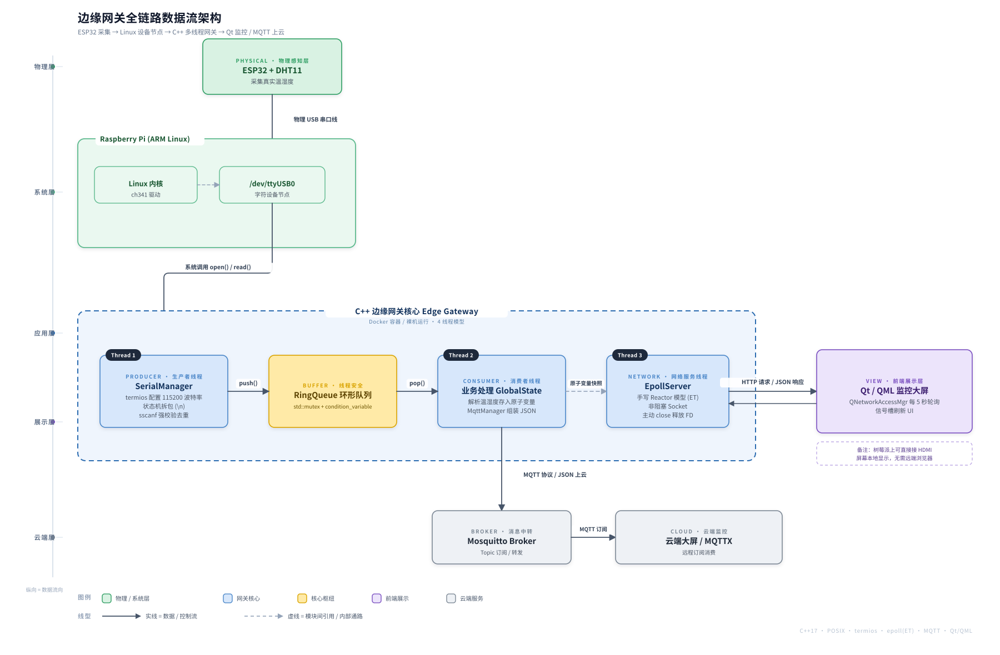
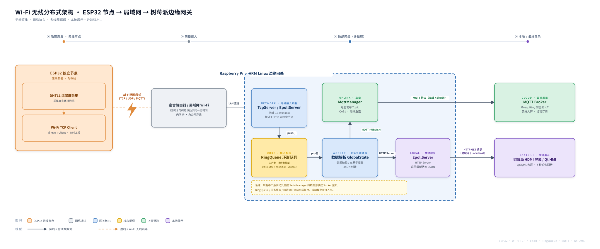

# Linux Edge Gateway & Qt HMI Monitoring System

基于 C++17、Linux 系统编程与 Qt/QML 开发的边缘计算网关与 HMI 监控系统。通过 ESP32 物理硬件采集环境数据，经过底层多线程并发与 Epoll 网络处理，最终实现数据上云与本地大屏的可视化监控。

## 系统架构

### 1. 物理直连版
> *基于 USB 串口直连的工业级边缘网关架构*



### 2. Wi-Fi 分布式扩展版
> *展示了系统的可扩展性，仅需替换最外层接入层（`SerialManager` -> `TcpServer`），即可无缝支持无线传感器接入。*



## 项目目录结构

```text
Edge-Gateway-System/
├── edge_gateway/               # C++ 边缘网关核心服务
│   ├── include/                # 头文件
│   │   ├── EpollServer.hpp     # 基于 epoll (ET模式) 的高并发网络服务器
│   │   ├── SerialManager.hpp   # 串口管理层 (termios/粘包/去重)
│   │   ├── MqttManager.hpp     # MQTT 上云通信层
│   │   ├── RingQueue.hpp       # 线程安全环形队列
│   │   └── GlobalState.hpp     # 跨线程共享的原子变量
│   ├── src/                    # 源文件实现
│   ├── tests/                  # 单元测试
│   │   └── test_ring_queue.cpp # GoogleTest 多线程并发压测
│   ├── Dockerfile              # Docker 多阶段构建脚本
│   ├── config.yaml             # 外部 YAML 动态配置 (串口/MQTT参数)
│   └── CMakeLists.txt          # CMake 构建脚本
├── qt_dashboard/               # 前端展示层 (Qt/QML HMI)
│   ├── Main.qml                # 监控大屏 UI 界面
│   ├── backend.h               # 后端网络请求逻辑
│   └── main.cpp                # 引擎启动入口
├── docs/                       # 架构图静态资源
│   ├── architecture_usb.svg
│   └── architecture_wifi.svg
├── start.sh                    # 一键编译启动脚本
└── README.md
```

## 本地快速启动

**环境要求**：WSL2、Docker Desktop、ESP32

### 1. 物理硬件挂载 (Windows PowerShell - 管理员)

```powershell
usbipd list
usbipd attach --wsl --busid 2-2
```

### 2. 一键启动全栈系统 (WSL2 / Linux 终端)

进入项目根目录，执行自动化启动脚本：

```bash
cd ~/workspace/Edge-Gateway-System
./start.sh
```

> 将物理串口控制权从 Windows 移交给 WSL2（注意替换为实际 BUSID，例如 `2-2`）：
> 首次接入该设备需先执行一次 `usbipd bind --busid 2-2` 完成绑定；此后重新插拔或重启 WSL，只需重复 `attach`。  
> 挂载成功后，在 WSL2 中执行 `ls -l /dev/ttyUSB*` 应能看到设备节点。
